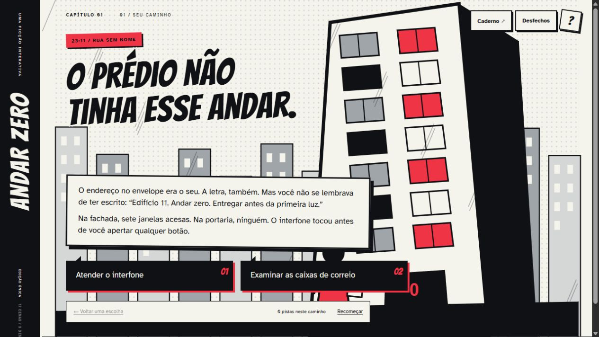

# Andar Zero

Uma ficção interativa ilustrada sobre um envelope sem remetente e um prédio que tenta não esquecer. Uma página de HQ que responde às escolhas do leitor.

**[Ler a história](https://gustapaz.github.io/andar-zero/)** · [Código](https://github.com/gustapaz/andar-zero)



## Experiência completa

17 cenas em três capítulos, seis pistas possíveis e três desfechos. Os caminhos se encontram em alguns pontos, mas as pistas recolhidas determinam quais escolhas ficam disponíveis. Uma pista pode ser encontrada por mais de uma cena, sem duplicar o inventário.

O caderno registra as cenas e pistas da leitura atual, permite voltar a uma decisão e pode ser baixado em TXT. Voltar refaz o inventário daquele caminho; finais encontrados continuam guardados. O arquivo de desfechos permite reler apenas os finais já alcançados. Recomeçar conserva os finais e oferece restauração do caminho anterior no aviso. Não há cronômetro, som automático ou sustos repentinos.

Opções de texto ampliado e leitura sem ilustrações; navegação por controles HTML, teclado e diálogo nativo. As ilustrações geométricas originais em SVG acompanham sete ambientes da narrativa. Lugares e personagens são inteiramente fictícios.

## Stack

Mithril 2 + TypeScript 6 + Vite 8, CSS próprio e SVG. Bangers e Atkinson Hyperlegible distribuídas localmente. Vitest testa o grafo da história, requisitos, persistência e exportação. Nenhum framework, shell ou CSS dos projetos anteriores foi copiado.

```sh
npm ci
npm run dev -- --host 127.0.0.1
npm run check
npm test
npm run build
npm run preview -- --host 127.0.0.1
```

Requer Node.js 24. A aplicação local usa `/andar-zero/`. O build estático fica em `dist/`. Todas as áreas usam a mesma URL; ao recarregar, a história abre na cena salva, sem precisar de fallback de rotas no servidor. GitHub Actions testa e publica no GitHub Pages.

## Dados, privacidade e limites

Todo o conteúdo está em `src/story.ts`; não há backend, API de aplicação, banco, conta, serviço de IA ou análise de tráfego. Armazenamento local na chave `andar-zero:reading:1`. Hospedagem e ferramentas gratuitas, sem cartão, trial ou faturamento ativado.

Não há sincronização entre dispositivos. Apagar os dados do site remove o progresso; a última gravação prevalece entre abas. O TXT é um registro para ler, não um arquivo reimportável. O retorno de um reinício fica disponível na sessão enquanto o aviso é mantido. Não há cache offline garantido nem proteção contra edição manual do armazenamento; este é um jogo local sem ranking.

O progresso validado contém um caminho possível da história, preferências e os identificadores dos finais encontrados. Não existe coleta de dados do leitor. A leitura sem JavaScript apresenta apenas a introdução; a HQ completa é renderizada no cliente.

## Design e validação

A [direção visual](docs/design.md) registra a composição de HQ e as diferenças para o portfólio. O [registro de validação](docs/validacao.md) descreve os testes realizados e seus limites. Não são atribuídas notas de Lighthouse nem certificação completa de acessibilidade.

Código, história e desenhos originais sob MIT, Gustavo Paz. As licenças de Mithril, Bangers e Atkinson Hyperlegible estão preservadas em `docs/`. Não são usadas imagens remotas ou recursos de áudio.
